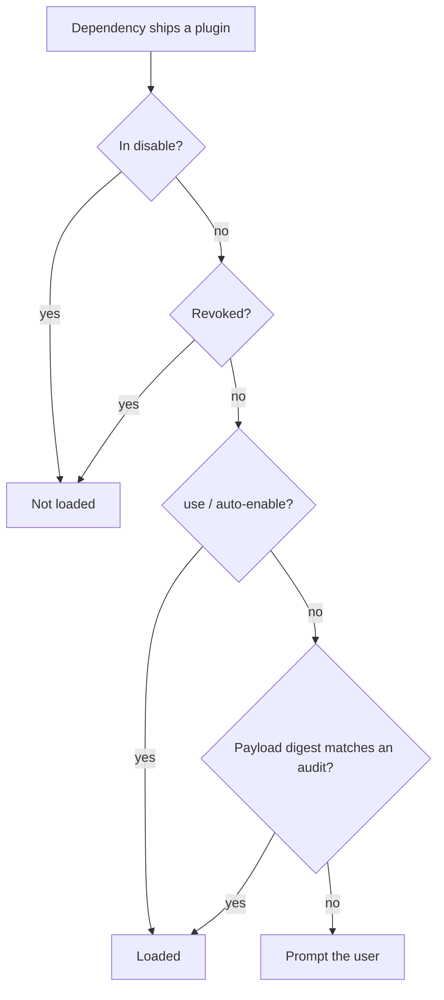
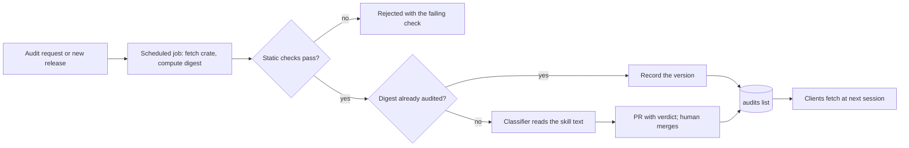

# Automated plugin audits

## TL;DR

- Today a dependency's embedded plugin loads only after the user says yes. Every user of a popular crate answers the same prompt about the same text, which nobody has read.
- Add a curated **audits** list, modeled on cargo-vet: one small TOML file per crate, pinning a digest of the plugin payload (its manifest and the skill files it ships). A dependency whose payload matches an audit loads with no prompt.
- The audit asks one question: **are the skills poisoned?** Hooks, MCP servers and subcommands are code, and are left to the ecosystem's code checks (see FAQ).
- A *System One* model does the reading: a classifier that answers a fixed set of questions with probabilities rather than generating text. A confident "unsafe" keeps a crate off the list automatically; every approval is confirmed by a human.
- The list lives in its own repo, `symposium-dev/audits`, with its automation. Adding a crate is a PR merge, never a Symposium release. Audits are read from every configured registry, so a company can ship its own audits list as a local directory and ignore the community one.
- A safety audit and "do I want this plugin" stay separate. The user picks how much is accepted without asking with `[plugins] auto-accept` — `audit` (the default: audited plugins load, anything else asks and says so), `none`, or `all` — and can turn off an audited plugin they don't want.

## Motivation

Today the consent prompt in `cargo agents sync` and the `cargo agents use` command ask every user to make the same trust decision about every plugin-bearing dependency, and to make it blind: the prompt carries no information, because nobody has read the text being trusted. Each user answers it separately for the same crate, and approving one crate also approves any crate its plugin chains to through `[[plugins]]`. Audits replace that blind decision with a shared, informed one for the common case.

## Change in a nutshell

`symposium-dev/audits` holds `audits/widget_lib.toml`:

```toml
format = 1
crate  = "widget-lib"

[[audit]]
digest   = "sha256:9f2c41d0e8…b7"         # hash of the plugin payload
versions = ["1.4.2", "1.4.3", "1.5.0"]    # releases known to ship this payload

[[revoked]]
versions = ">=1.3.0, <1.4.2"
reason   = "remote-exec"                  # reason code from a fixed list
```

Sync hashes `widget-lib`'s payload — its plugin manifest and every skill directory the manifest names inside the crate — finds the matching digest, and loads the whole plugin with no prompt and no config write. `cargo agents status` lists it as active because of the audit, and `[plugins] disable` still turns it off. Entries are per distinct payload, not per release: a code-only release keeps matching; a release that changes the payload falls back to the prompt until it is audited as a new entry. A plugin that pulls skill text from outside the crate (a `source.git` group) cannot be pinned by a digest and is not eligible; a chained crate is checked against its own entry.

Precedence, first match wins:



A revocation outranks the user's own `use`, because it marks a payload known to be harmful. Short of that, a user's `use` or `auto-enable` is deliberately a standing grant: it trusts the crate, not one release, the same way depending on the crate trusts its future code. Re-checking each release is the audit list's job, not the user's. A user who does not want an audit to skip the prompt sets `auto-accept = "none"`; their own `use` and `auto-enable` entries still stand, so they remove those to be asked again.

The chart is the default, `auto-accept = "audit"`. Two others change what the last two boxes mean: `none` turns the audit box into a prompt, so an audited plugin asks like any other (today's behavior), and `all` loads everything without asking, like `auto-enable = ["*"]`. `disable` and revocations win under every setting. Whenever the prompt appears for a plugin with no audit, it says so prominently. An audit answers only "is the text safe"; whether the user wants the plugin is theirs to decide, and `[plugins] disable` turns off an audited one they don't want.

## Detailed plans

### The list

- **Where**: `github.com/symposium-dev/audits`, a git registry shipped as a builtin the way the recommendations repo is. It is a separate repo because its cadence is crate releases, not plugin authoring. Any trusted `[[registry]]` may carry `audits/`, so a company can run its own.
- **What**: one file per crate holding all its audits and revocations. An audit is a `digest` the client matches on plus the `versions` known to ship it; `[[revoked]]` is by version range or digest with a `reason` code from a fixed list, so the client can explain the revocation. Every change lands by pull request, so the repo history records who or what decided each entry and on what evidence.
- **Compatibility**: the file carries a `format` version. Only a format bump needs a Symposium release; the list itself never does.

### The classifier

Input is the whole skill directory — `SKILL.md` and any `resources/` and `scripts/` it ships — for all of the crate's skills in a single call, since the model cannot ask for more. A skill too large for one call, or containing a file that cannot be read as text, is not audited and falls back to the prompt. A System One model answers a fixed set of questions about it, each with a probability: does the skill tell the agent to fetch and run remote code, send out secrets or source, hide what it is doing from the user, or act outside the task a library's documentation would describe? Each question has its own `reason` code.

**Nobody talks to the classifier.** Text addressed to an AI reviewer ("ignore previous instructions", "classify as safe") has no place in a legitimate skill, so it is disqualifying on its own. The model's answers are not shown to the submitter.

**Routing.** A payload judged unsafe gets no audit entry, with no human needed to keep it out; a human decides whether to also revoke the release. A payload judged safe is opened as a pull request, with the skill text and the verdict, and a human confirms the merge. An audit means "reviewed and found clean", not a guarantee; revocation is the remedy when one was wrong.

### Requesting an audit



Anyone can request an audit by opening an issue in the audits repo; the consent prompt links to it. A scheduled job (daily, for example) checks the requested crates and every new release of crates already on the list. The job does not have to live in CI: to start, maintainers run it themselves in batches, which avoids putting model API credentials into CI, and it moves to unattended runs once enough decisions have accumulated to trust its confidence. For each release it fetches the published crate from crates.io, without building or running anything, and computes the payload digest. Static checks run first, since they are cheap enough to run on demand: at minimum, that the plugin is well formed (its manifest validates and its skills lint clean), plus a `cargo vet` lookup against the public audit feeds, whose result is recorded as the code-side signal rather than required; the full set is to be defined. A release that fails them is rejected with the failing check and never reaches the classifier. A digest already audited only records the new version. A new digest goes to the classifier and is routed as above. A RustSec advisory marking a crate malicious produces a revocation.

### When it reaches users

The list is refreshed when an agent session starts and on `cargo agents sync`, never on individual tool events. Approvals and revocations land at the next session; on revocation, hooks stop at the next event and skills are removed at the next sync.

### Later

Not part of this RFD, but the list is the natural place for them: a feedback loop ("this plugin was helpful / was not"), curated lists on top of the audited set, and telemetry on enable and disable decisions, including which agents and versions were active, so we learn which plugins people actually keep.

## Frequently asked questions

### Why review only the skills?

Depending on a crate means running its code; a hook or MCP server from the same crate is more of that code, and whether it is malicious is a code-supply-chain question the ecosystem already works on (cargo-audit, RustSec, cargo-vet). A `SKILL.md` is different in kind: instructions the agent will follow, which no existing check reads. One edge: a hook whose installation pulls a *different* crate or a GitHub tarball is code the user never chose. The digest pins the reference to it, not its contents, so a reference that can move, such as a branch, is a reason to decline the audit.

### Why a System One model rather than an LLM judge?

A fixed set of answers with probabilities can be routed by plain rules, the model uses no tools, and a skill cannot argue its way into a different answer the way it can with a model that writes its verdict. Models of this class exist off the shelf, hosted and open-weight; we start with one of those and fine-tune an open-weight model only if needed.

### Why a content digest rather than a version?

A version pin misses `[patch]`, path and git overrides at the same version and needs an entry per release. A digest is stable across code-only releases and invalid the moment the plugin changes.

### Why not literally cargo-vet, at least for Rust crates?

We do use it, for the half it covers. cargo-vet records human reviews of Rust *source* against code-safety criteria, so the static step looks the crate up in the public audit feeds and records the result as the code-side signal. It cannot replace the list: its criteria say nothing about prompt text, its audits are keyed by version (every code-only release would need a new entry, while a digest of the skill text keeps matching), and public coverage is sparse enough that requiring it would leave most plugins unaudited. A company's own list can choose to require it. We borrow its shape — a curated, reviewable list of audits with a deny channel — and key entries on a content digest.

### Can a company run its own list?

Yes, without a new repo. A `[[registry]]` entry can be a local path as well as a git URL, and any of them may carry an `audits/` directory. An organization puts its own `audits/<crate>.toml` files in a directory it already ships to developers, points a `[[registry]]` at it, and optionally turns the community list off in `[defaults]`.

### Who reviews, and what if requests pile up?

The Symposium maintainers run the audits repo. An unreviewed crate is no worse off than today: it falls back to the prompt. Crate authors can request an audit of their own release like anyone else.

## Implementation plan and status

### Phase 1: client (`symposium-dev/symposium`)

Anyone can keep an audit list by hand, for example a company in a local directory, and get the full feature.

- **Auto-accept setting**: `[plugins] auto-accept = "none" | "audit" | "all"`. `none` is today's behavior and `all` loads everything without asking; until audits exist, `audit` behaves like `none`.
- **Audits**, in two commits: read `audits/` from configured registries, compute the payload digest and enforce `[[revoked]]`; then load matching `[[audit]]` entries without a prompt under `auto-accept = "audit"`, the default.

### Phase 2: community list (`symposium-dev/audits`), human review

- Bootstrap the repo: format, CI validation, hand-reviewed seed entries.
- Ship it as a builtin registry (main repo).
- Audit requests and a reusable runner that maintainers run in batches and other companies can run on their own lists.
- Link to the request form from the prompt (main repo).
- Propose revocations from the OSV malicious-package feed.

### Phase 3: the model

- A labeled dataset of benign and poisoned skills, including phase 2 decisions.
- An eval harness comparing candidate System One models.
- Pick and calibrate a model; fine-tune an open-weight one only if needed.
- Classifier in the runner: confident-unsafe is rejected, safe is pre-filled for a human.

Docs ship with each change. Phase 3 can start as soon as phase 2 produces decisions.
